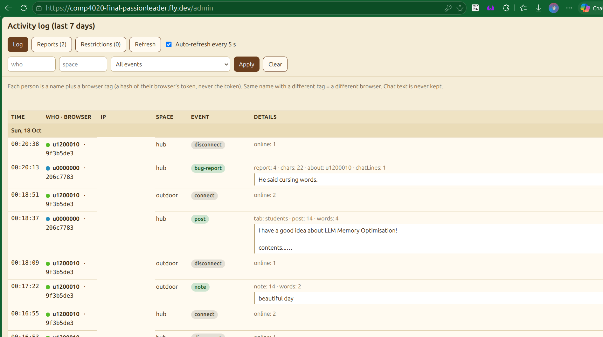
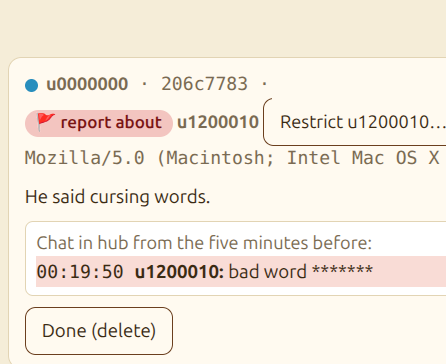
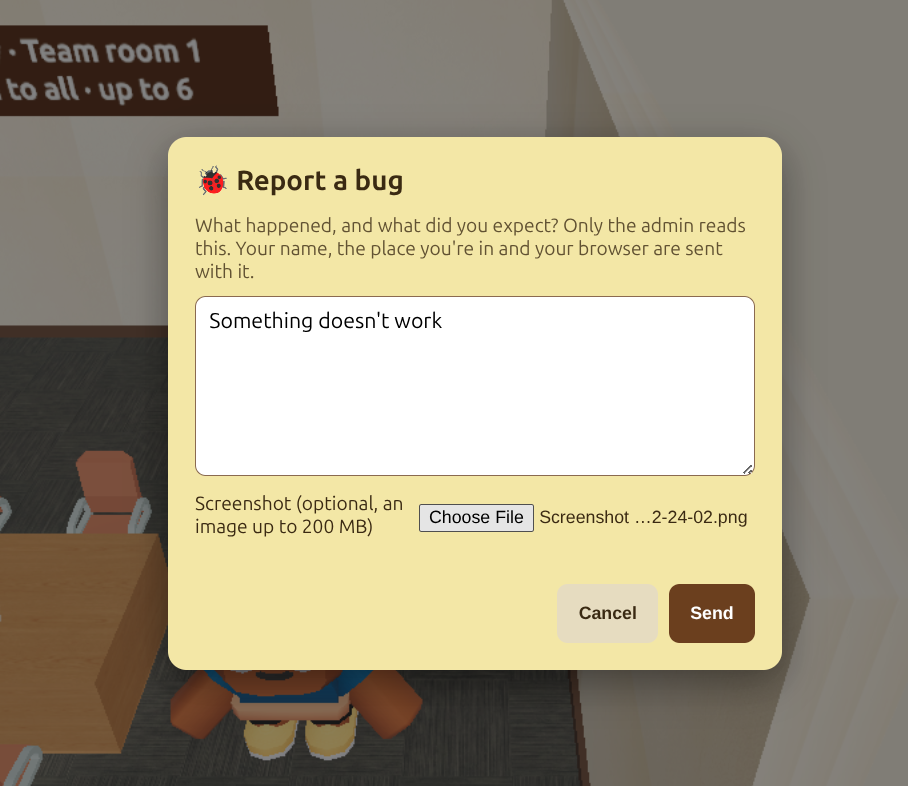
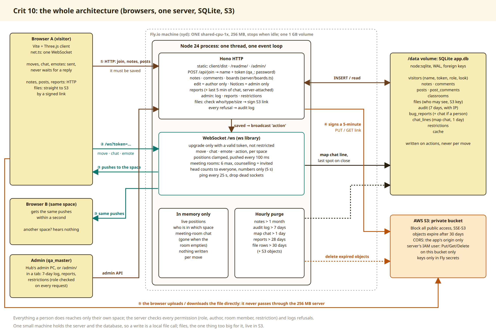
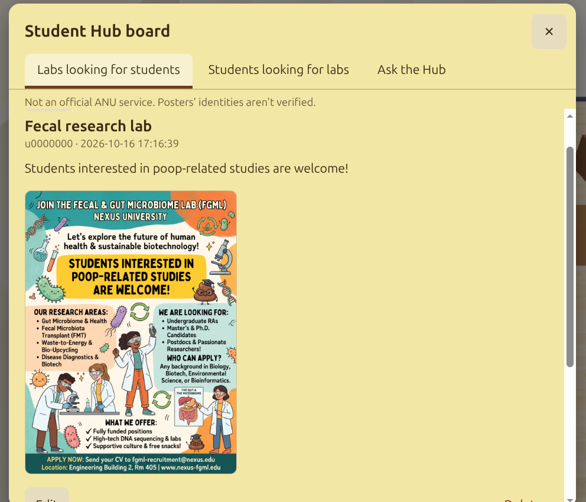

# Process overview

## Crit 10: two people, read from the log

This week the app learned to tell people apart and to decide, on the server,
what each of them may see and change. Who may do what, and why, is written
down in [`docs/decisions/002`](docs/decisions/002-who-may-see-and-change-what.md).

I rehearsed the crit with two people in two browsers, reading only the
admin's log:

- **u1200010** joined, then **u0000000**.
- u1200010 stuck a note saying "beautiful day".
- u0000000 posted in the Student Hub board's "Students looking for labs" tab
  that they had a good idea about LLM memory optimisation.
- u0000000 reported someone. The report was about u1200010, and it carried
  the line u1200010 had just said in the Hub:

The log showed the report as `bug-report`, so I had it renamed
`person-report` the same night
([2a6908e](https://github.com/comp4020-agentic-coding-studio/comp4020-final-passionleader/commit/2a6908e)).
Each person in the log is a name plus a short hash of their browser's token,
so the same name from another browser shows up as someone else
([d1a50b3](https://github.com/comp4020-agentic-coding-studio/comp4020-final-passionleader/commit/d1a50b3)).

## What the admin can see and do

Accounts come in four kinds: guest and ANU staff (both planned), ordinary
users, and the server admin. Ordinary users are kept out of the log: the
admin page asks the server for everything, and the server refuses anyone
but the admin.

The admin account reads, at the admin PC in the Student Hub, the IP,
username and actions of everyone (including what a sticky note said)
([9fe0e7f](https://github.com/comp4020-agentic-coding-studio/comp4020-final-passionleader/commit/9fe0e7f)).
Because this includes sensitive data like IPs, the server keeps it for seven
days only. When someone behaves badly, the admin can watch the log and then
stop that person from notes, posts, chat or coming in at all
([919fbc5](https://github.com/comp4020-agentic-coding-studio/comp4020-final-passionleader/commit/919fbc5)).
Every refusal is logged with its reason, so the log says what was tried as
well as what happened
([114ae4f](https://github.com/comp4020-agentic-coding-studio/comp4020-final-passionleader/commit/114ae4f)).

Users can report a bug and attach a screenshot, which the admin reads on the
same page; the file is stored in S3. Users can also report a person, for
example someone swearing, and the admin sees the last five minutes of chat
in that space with it.

## Files in S3, and why

The Fly machine is small (256 MB, a 1 GB volume), so files shared in meeting
rooms, attached to bug reports and attached to board posts go to AWS S3
instead ([606b59d](https://github.com/comp4020-agentic-coding-studio/comp4020-final-passionleader/commit/606b59d)).
I chose S3 because it handles attachments cheaply. I created a separate IAM
user for the server myself and gave it only what it really needs: read,
write and delete on that one bucket. The bucket's lifecycle deletes
everything after 30 days, and separately the server deletes a file itself
once it decides it has expired (a removed post, an emptied room).

## A space to communicate

To finish the "communication space", I added Chifley Library
([f480247](https://github.com/comp4020-agentic-coding-studio/comp4020-final-passionleader/commit/f480247)),
meeting rooms ([ed5d0ef](https://github.com/comp4020-agentic-coding-studio/comp4020-final-passionleader/commit/ed5d0ef))
and boards that can play EdStem's role
([ea18534](https://github.com/comp4020-agentic-coding-studio/comp4020-final-passionleader/commit/ea18534)).
In team rooms and counselling rooms, up to six people can share files and
work together. For coursework students looking for a lab, and academics
looking for students, the Student Hub now has recruiting boards
([f13eaef](https://github.com/comp4020-agentic-coding-studio/comp4020-final-passionleader/commit/f13eaef)),
so the place carries both formal and informal talk between students, staff
and academics.

I worked hard on new building textures and new background music, so that
people feel "this cyberspace is a real place" and settle into it. I made the
textures and music with Google Gemini
([e23c0e2](https://github.com/comp4020-agentic-coding-studio/comp4020-final-passionleader/commit/e23c0e2),
[2d2a234](https://github.com/comp4020-agentic-coding-studio/comp4020-final-passionleader/commit/2d2a234)).

## How I directed, grounded and corrected

- **A report showed up as a bug.** I found it while doing QA myself and
  shared what I saw. The agent explained the cause: the report's target went
  through the 8-character name rule, so `qa_master` was thrown away. I had it
  fixed so an unknown name is refused, not filed as a bug, and a test now
  holds that
  ([919fbc5](https://github.com/comp4020-agentic-coding-studio/comp4020-final-passionleader/commit/919fbc5)).
- **A decision met a new feature.** Decision 001 said chat is never kept,
  which a report needs. I revised 001 so only map chat is kept, for a day,
  read only with a report (same commit), and the rule went into `CLAUDE.md`.
- **Phones.** I found the volume, new-tab and zoom bugs on my own phone
  ([276292a](https://github.com/comp4020-agentic-coding-studio/comp4020-final-passionleader/commit/276292a)).
  Automated QA can't play out the strange things a real user does, so a
  person still has to test by hand.

## How I plan: two notes

I write two files by hand in Korean, outside the repo: a plan (what and
why) and a numbered checklist (each task, ✅ and its commit). From them the
agent writes and updates the repo's English documents
([b83c85b](https://github.com/comp4020-agentic-coding-studio/comp4020-final-passionleader/commit/b83c85b)):
[`docs/plan.md`](docs/plan.md), `CLAUDE.md` and
[`docs/roles.md`](docs/roles.md). The submitted documents start from my own
drafts in those notes. Managing the project takes only two files, and
because everything is written down, Claude works fast without asking me the
same things again. The notes aren't committed because they're in Korean.

Two sessions still split the work: an Opus main session owns the server,
deploys and every commit, and a Sonnet helper builds self-contained pieces
and does local QA.

## Stack, and why WebSockets

Three.js in the browser; Hono on Node 24 serving the client, the API and a
WebSocket from one process; SQLite on the Fly volume; S3 for files. Other
people's positions have to be on screen live, so each tab sends its position
only when it moves, and the server pushes everyone's in that space every
100 ms ([3f19511](https://github.com/comp4020-agentic-coding-studio/comp4020-final-passionleader/commit/3f19511)).
WebRTC would take the server out of the path, and with it the log and the
rules this crit is about; polling can't keep up with ten people moving. I
ruled out managed Postgres and Redis: they cost money and add processes to
one small machine. The cost of that choice is in 002: the database sits on
the same internet-facing machine as the server.
