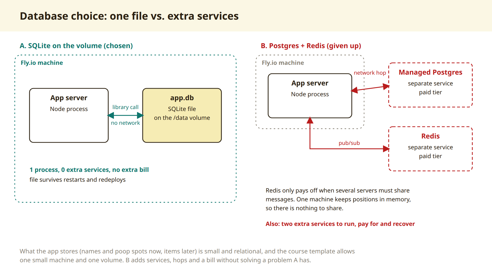

# Process overview

## Crit 9: everyone at once

Crit 8 was a toilet you could leave one poop in. This week it became live and
turned into a small ANU campus: a stretch of campus between buildings 155 and
154, the Student Hub and a COMP8020 classroom, joined by doors. Everyone in a
space sees everyone else walk, chat, wave, dance and stick notes within a
tenth of a second. The real-time layer, built first, is what made the change
of direction cheap. Free assets and Gemini (sky, textures, music) did the rest.

## Why it changed direction

Poop is a good excuse for strangers to get close, but I wanted something with
real use: a place people can actually interact in, worth using at a real
university. Students and academics almost never meet informally at ANU, so
finding a supervisor or a student for a lab depends on luck. A shared space
with the Student Hub, a stretch of campus and course classrooms gives them
somewhere to bump into each other. I wanted it to be original, so before
committing I had the agent read the README of every other public
final-project repo in the course (108 of them) and tell me only whether anyone
was doing the same thing. One is close and a few partly overlap, so I kept my
angle on staff and students meeting rather than campus places as such.

I also cut parts of my own plan once I knew what wasn't possible: Echo360 in a
classroom needs ANU login and can't be re-broadcast; real ANU sign-in isn't
available to a student app; chat translation needs a paid service. The full
order, and what this week takes from it, is in [`docs/plan.md`](docs/plan.md).

## How I plan: one hand-written note

I keep plan, spec and sprint in one Markdown file outside the repo, written
almost entirely by hand in Korean: really an idea notebook and developer's
log. Ideas, specs, reflections, harness rules and each session's role go in
there first; then I ask the agent to carry them into `docs/plan.md`,
`CLAUDE.md` and the rest. Whenever a new idea comes up mid-build, it goes into
that note before it goes into code. The note is mine and is never committed.
The agent's job on it is review: what's impossible or risky. This week that
review turned "Echo360 in a classroom" into a question board, and a long
wish list into this week's steps 1–9 and next week's rest.

## Why WebSockets

A board or an arcade game can pass a fixed state around synchronously; here I
need other people's positions on screen live, and to interact with them. So I
chose an event-driven, asynchronous WebSocket: each tab sends its position
only when the character has moved, at most ten times a second, and never waits
for an acknowledgement. The server keeps positions in memory and pushes them to
everyone in the same space every 100 ms. Sockets are what online RPGs usually
use, and coming from DevOps at a game company, this was the case I wanted to
apply. The database side is synchronous (SQLite through `node:sqlite`), but it
is only written for notes, comments and a visitor's last spot when they leave,
never for each move.

I considered three alternatives:

- **WebRTC** (browser to browser) is built for voice and video. With no server
  in the path, the server can't log actions (crit 10 asks for exactly that),
  enforce rules like the note limits, or save anything, and it needs a relay
  on locked-down networks like campus Wi-Fi. It may come back for voice only.
- **Server-sent events** only go one way; every move would still need its own
  HTTP request back.
- **Polling** can't reach "within a second" for ten people moving at once
  without hammering one small machine.

The protocol stays generic: the server knows "move", "enter", "chat", "emote"
and "action", not "poop" or "note", because the spaces and what people do in
them keep changing. That is why sticky notes replaced poops as just another
kind of "action", with no new message type. What lasts and who sees it is decided in
[`docs/decisions/001`](docs/decisions/001-what-lasts-and-who-sees-it.md).

## How I worked with the agent

**Two sessions, written down.** In crit 8 I split the work by instinct. This
week I wrote it into [`docs/roles.md`](docs/roles.md), linked from `CLAUDE.md`
so every session reads it: an Opus main session at high effort owns the
server, shared client files, deploys and every commit; a Sonnet helper at
medium effort builds self-contained modules and does local QA. One committer
keeps the history readable, and the split saved credits as well as time.

**Corrections that became rules.**

- Poops kept vanishing. The final-project template's `fly.toml` doesn't set
  the database path that crit 7's did, so the database sat on the machine's
  wiped disk and reset on every deploy and auto-stop. The image now sets it,
  and I checked by restarting the machine with a poop in place.
- Resetting the live database took several tries (a mangled one-liner through
  `flyctl ssh`, a wrong working folder, and a stopped machine whose error never
  reached my screen). It's now `scripts/reset-db.ts`, run after
  `flyctl machine start`.
- Live testing goes through named test accounts only, never the spec suite, so
  the rooms people see aren't full of random names.
- The rule that photos of real buildings are references only did its job: the
  Gemini sky I generated had buildings that looked like a real campus along
  the bottom, so only its clouds and sky were kept.

## Stack

Three.js for 3D in the browser; Hono on Node 24 serving the client, the API
and the WebSocket from one process; SQLite on the Fly volume. I ruled out
managed Postgres and Redis: they cost money, add processes to one small
machine, and with a single server there's nothing for Redis to share.
Colyseus would give me rooms out of the box, but my rooms are simple enough
that plain `ws` with one channel per space keeps the protocol in my hands.
