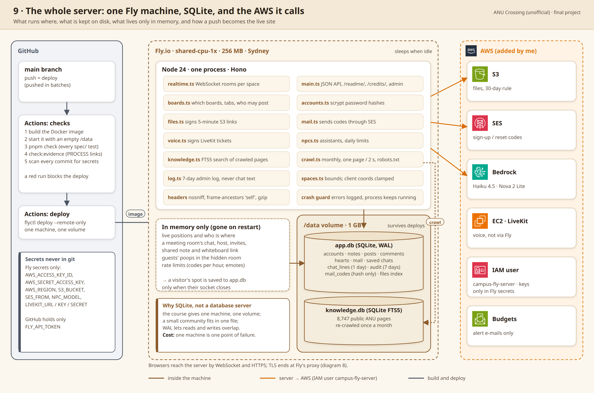
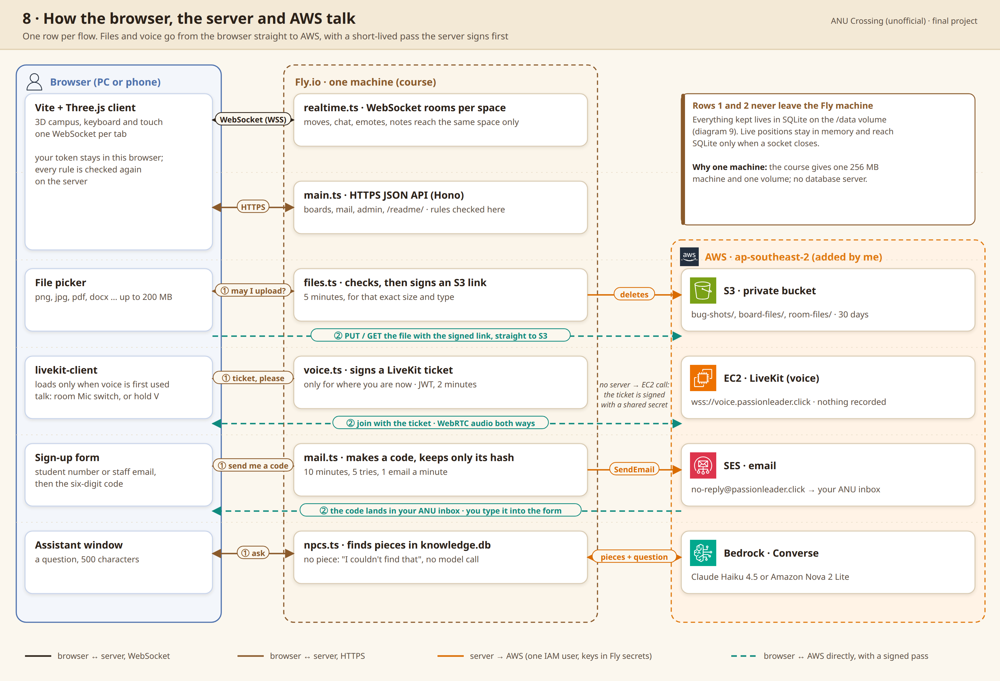
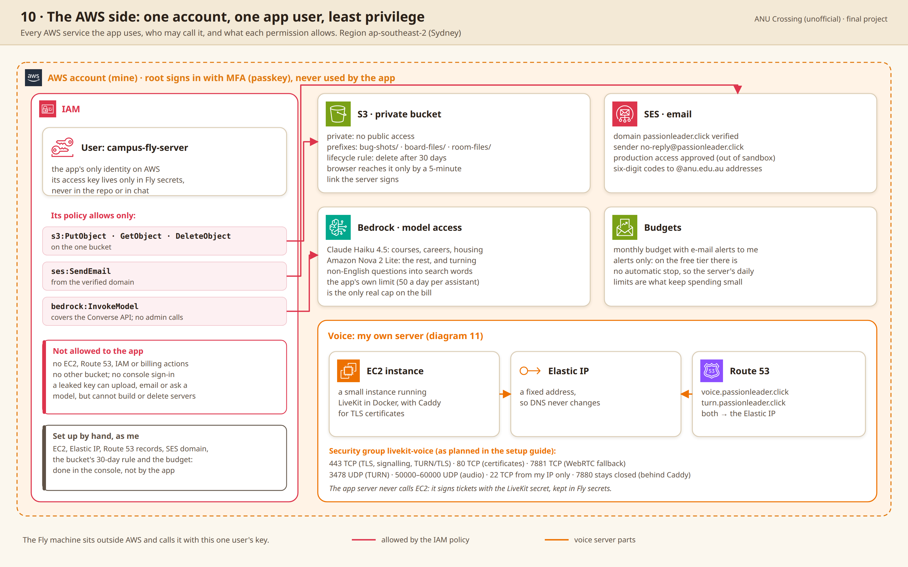
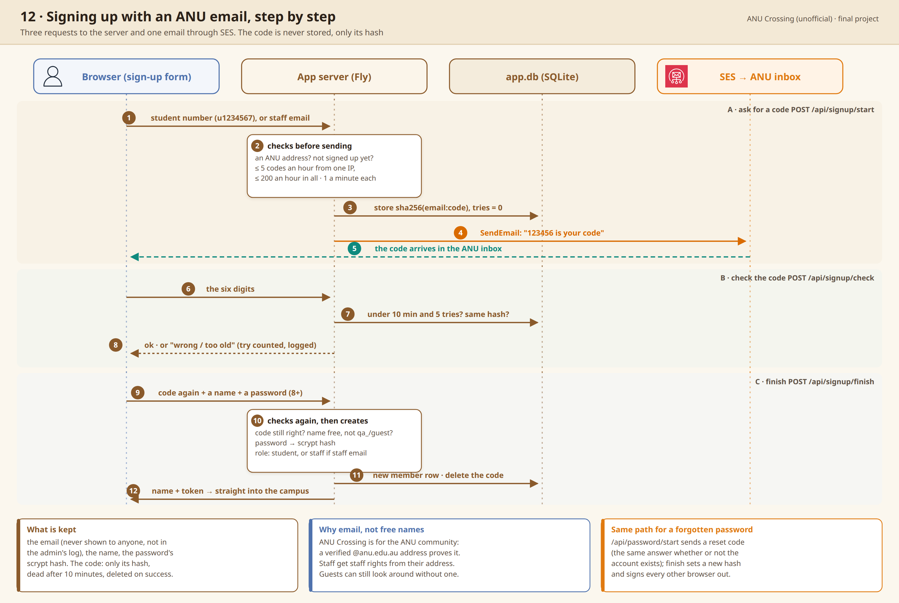
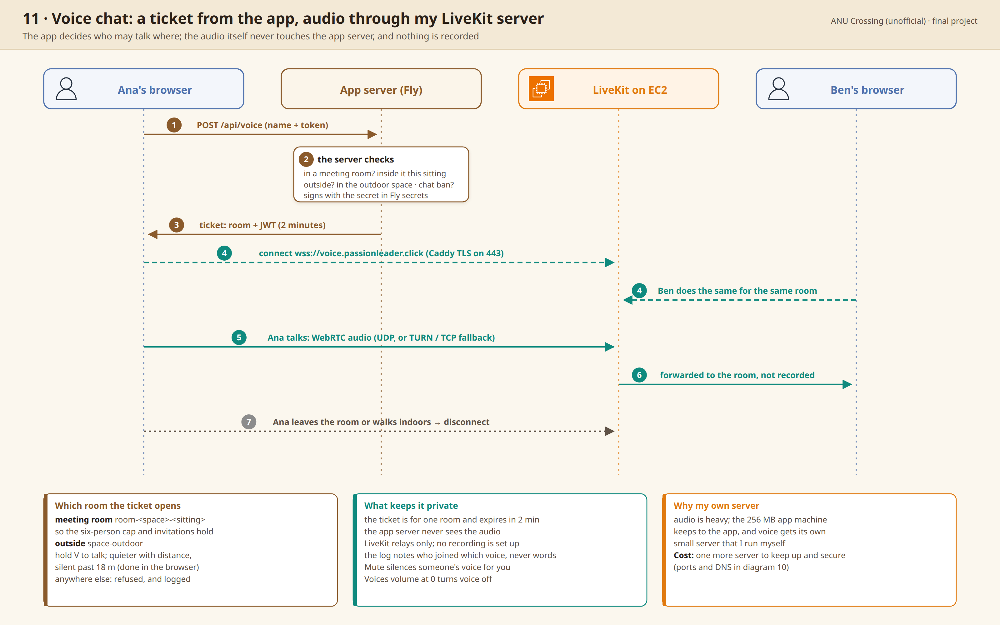
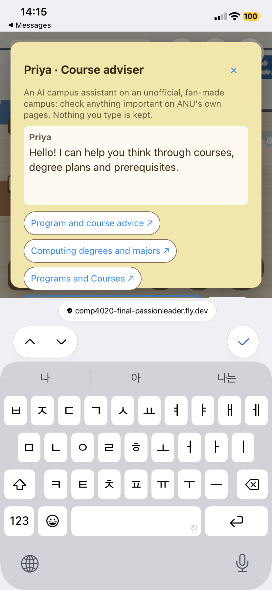

# Process overview

## The stack, and what it cost

The course fixed the server's shape: one 256 MB Fly machine, one volume, no
database server. That constraint chose most of the stack. Positions and chat must reach everyone at once, so the server speaks
WebSocket and keeps positions in memory until someone leaves. Everything that lasts sits in SQLite. I
looked at RDS early on, but for a small community with simple rules it would
have been overkill. The downside is that one machine is one point of failure, and the database shares it
with the server.

Fly and GitHub Actions came with the course. AWS is what I added and set up
myself. Media was the reason. A big club poster or a team's files won't fit on
a 1 GB volume, so files go to a private S3 bucket
([606b59d](https://github.com/comp4020-agentic-coding-studio/comp4020-final-passionleader/commit/606b59d)). The browser uploads straight to S3 with a five-minute signed
link, and the bucket deletes everything after 30 days. It costs a little, but I had credit. SES sends the sign-up codes ([d6ffb2d](https://github.com/comp4020-agentic-coding-studio/comp4020-final-passionleader/commit/d6ffb2d),
[decision 005](docs/decisions/005-sign-up-with-an-anu-email.md)), Bedrock
runs the assistants ([decision 003](docs/decisions/003-assistants-answer-only-from-anu-pages.md)),
and voice runs on my own t4g.small EC2 with LiveKit, since audio is too heavy
for the app's machine ([decision 004](docs/decisions/004-voice-on-its-own-server.md)).

The app reaches AWS as a single IAM user with three permissions, and I wrote
that policy by hand, one action at a time. This was the part AI didn't do for
me and shouldn't. Spending is capped in code: the assistants
stop at a daily limit and say plainly when the credit has run out
([7354a25](https://github.com/comp4020-agentic-coding-studio/comp4020-final-passionleader/commit/7354a25)). AWS Budgets only emails me, since the free tier has no
automatic stop. So the server's own limit is what stops spending.

## My position on the sources

Youssef et al. (2024) found that metaverse platforms built young people's
social skills, but in the UAE and across platforms in general. One campus app can't claim the same, so the README lists 'talking
gets easier' as judged rather than proven. Reber and Sweller convinced me
that a familiar place takes less effort, which is why I checked the map
against OpenStreetMap instead of trusting my memory ([1068101](https://github.com/comp4020-agentic-coding-studio/comp4020-final-passionleader/commit/1068101)). I kept the
layout, only at a smaller scale. Lee et al. (2023) found students felt more
like a team on Gather.Town than on Zoom. That's my case for a space with
avatars rather than one more video call. Bulu (2012) ties co-presence to
satisfaction, so the live count is the thing I care about most.

## How I planned: a plan file, a checklist, weekly bundles

My notes live outside the repo in Korean. `Integreted_plan.md` collects
ideas as they come, and I only add. From it grew a numbered
checklist ([translated](docs/checklist.md)): whatever I want in a week goes in as a new number, and what's done
gets ticked with its date and commit. The same numbers appear in commit
messages, so '97:' in a message points to checklist item 97 ([0d920b2](https://github.com/comp4020-agentic-coding-studio/comp4020-final-passionleader/commit/0d920b2)).
The agent turned these notes into the repo's English documents, from the
plan and roles ([56b1b99](https://github.com/comp4020-agentic-coding-studio/comp4020-final-passionleader/commit/56b1b99), [238efdf](https://github.com/comp4020-agentic-coding-studio/comp4020-final-passionleader/commit/238efdf)) to the harness
([b83c85b](https://github.com/comp4020-agentic-coding-studio/comp4020-final-passionleader/commit/b83c85b)).

Work came in bundles, one budget week each, and the budget grew from $200
to $300 a week. Finishing inside it became a skill of its own. When ideas
outran the budget, I scored them with RICE. Day and night following
Canberra's clock came second, so it got built ([11a6335](https://github.com/comp4020-agentic-coding-studio/comp4020-final-passionleader/commit/11a6335)).

## How I directed agents, and what I fixed in the harness

I worked with several Claude sessions at once. The main session (Opus) builds
and commits, a helper (Sonnet) runs browser QA, and a cheaper one (Haiku)
puts test questions to the assistants. Their limits are in `docs/roles.md`, and I plan,
decide, check.

When something went wrong, I tried to fix the rule as well as the result.

- An audit, not a retry. For the final check I ran a multi-agent
  workflow: Sonnet agents searched the code for problems, and Opus verified
  each one. The fixes went into the code, some with a new check in `spec/`:
  admin-PC holders could lift each other's restrictions ([0d920b2](https://github.com/comp4020-agentic-coding-studio/comp4020-final-passionleader/commit/0d920b2)), and
  wrong passwords now meet a limit the spec tests ([d018a1e](https://github.com/comp4020-agentic-coding-studio/comp4020-final-passionleader/commit/d018a1e)). The first
  time, I put every searching agent on Opus. It burned budget
  and finished one area in thirty minutes, so I stopped it, and
  'search on Sonnet, verify on Opus' became the rule.
- Finding the cause, then a test. An assistant's E badge kept landing on a
  PC. The cause was that `/api/npcs` never sent each assistant's reach. Now it
  does, and the spec checks it ([3810938](https://github.com/comp4020-agentic-coding-studio/comp4020-final-passionleader/commit/3810938)).
- A rule written down twice. Where newcomers arrive went into `CLAUDE.md`
  and the spec together ([99c0bec](https://github.com/comp4020-agentic-coding-studio/comp4020-final-passionleader/commit/99c0bec)), so no later change can move it.
- QA that wasn't QA. Early on, the main session claimed testing from spec
  runs and a guest screenshot, and I found the test login broken myself.
  Since then browser QA goes to the helper, and untested means reported as
  untested. Haiku's results get rechecked too: many
  answers it called made up were on another page.

For the interface, I used the stageshow skill's design notes as a checklist:
one labelled Close for every window, one set of line icons, and nothing on a
phone hidden under another control ([a24ccbc](https://github.com/comp4020-agentic-coding-studio/comp4020-final-passionleader/commit/a24ccbc), [7be584a](https://github.com/comp4020-agentic-coding-studio/comp4020-final-passionleader/commit/7be584a), [24f6ba1](https://github.com/comp4020-agentic-coding-studio/comp4020-final-passionleader/commit/24f6ba1)).

## After crit 10

AI made building easy, so knowing the user became the hard part. At the
crit, a friend opened the app, stayed at the north end of the map and said,
'Wow, how did you build our campus?' They never went south and never found a
single feature. To them it was a game set at our university. A friend I
invited through Instagram thought it was a kind of playing house. I had to explain
every feature. That is why the minimap
([17e00c4](https://github.com/comp4020-agentic-coding-studio/comp4020-final-passionleader/commit/17e00c4)), the tutorial ([3aeb2b5](https://github.com/comp4020-agentic-coding-studio/comp4020-final-passionleader/commit/3aeb2b5)), quests that lead newcomers to
Robin in the library ([efaffc0](https://github.com/comp4020-agentic-coding-studio/comp4020-final-passionleader/commit/efaffc0)) and a Campus Guide with clips recorded
from the app ([b718b00](https://github.com/comp4020-agentic-coding-studio/comp4020-final-passionleader/commit/b718b00)) exist. The other big additions were email sign-up,
assistants answering from crawled ANU pages ([98fc799](https://github.com/comp4020-agentic-coding-studio/comp4020-final-passionleader/commit/98fc799)), voice, the
Career Hub, the campus at night.

I did the phone QA myself, because a desktop browser can't reproduce a phone,
and every UI issue came from my screenshots. The keyboard covered the AI
chat, a team room's panels filled the screen so the shared note was
unusable, and lamp light turned into coloured speckles on iPhones for a
while.

The fixes followed
([8371c85](https://github.com/comp4020-agentic-coding-studio/comp4020-final-passionleader/commit/8371c85), [0cbc1ed](https://github.com/comp4020-agentic-coding-studio/comp4020-final-passionleader/commit/0cbc1ed)). What is kept, and who sees it, is explained in
[decision 001](docs/decisions/001-what-lasts-and-who-sees-it.md) and
[decision 002](docs/decisions/002-who-may-see-and-change-what.md).

---

This and `README.md` drafted in Korean, translated by Claude.
