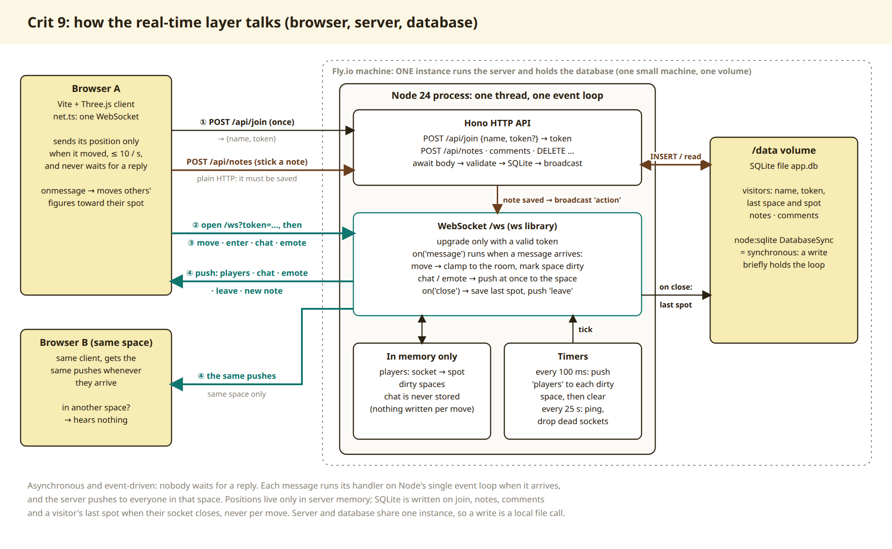

# 001: What lasts, and who sees it, when several people share a space

Status: accepted (crit 9)

## Context

The campus is for people who rarely meet informally, students and staff, to
run into each other. Several people are often in the same space at once, and
people come back later. Three questions decide how that feels and what it
costs:

1. Of the things people do, say and leave, what disappears and what stays?
2. Who receives what someone does: everyone online, or only the people in the
   same space?
3. Where does each of those live, on one small Fly machine (shared CPU,
   256 MB) that runs the server and holds the database together?

My README says a good space is a familiar one you can relax and socialise in.
Being somewhere means what you hear depends on where you stand, and small talk
doesn't follow you around forever.

## Options

**What lasts**

- A. Everything is kept: chat history and notes both persist.
- B. Nothing is kept: chat and notes both vanish when you leave.
- C. Chat is ephemeral (never stored, gone from screens after a minute);
  sticky notes stay until their author or an admin removes them.

**Who sees it**

- D. Everyone online sees everything, wherever they are.
- E. Only people in the same space see and hear each other, chat, emotes and
  notes; moving through a door changes who you're with.

**Where it lives**

- F. Managed Postgres for what lasts, Redis for live state and fan-out.
- G. One SQLite file on the machine's volume for what lasts; live positions
  only in the server's memory.

## Decision

**C, E and G.**

Chat is for the people in the room right now, so it's never stored and fades
after a minute. A sticky note is the deliberate trace, the one thing that's
there when you come back, so it stays. To stop it swamping a floor, each person
keeps at most five notes per space (a sixth replaces their oldest, after a
warning) and can post one every 30 seconds. Everything is scoped to the space
you're in: walking into the Student Hub means you stop hearing the campus
outside and start hearing the Hub.

I considered Redis + Postgres, but on one low-spec node it's a problem: it
costs money, and with a single server, Redis caching has nothing to share. So
I chose SQLite, which is light. Real-time over WebSocket was easy to decide,
because I planned for real-time communication from the start. Positions are
sent only when someone moves, the server pushes them to the space every
100 ms without waiting for a reply, and they never touch the database. Only
notes, comments and a visitor's last spot (when their socket closes) are
written, so someone coming back starts where they left.

## Trade-offs

- **Losing chat.** Someone who arrives a minute late misses the conversation,
  and nothing can be quoted back later. Anything worth keeping has to become a
  note.
- **Notes that never expire.** Old notes pile up and can go stale; removal
  depends on authors and on me as admin.
- **Spaces kept apart.** You can't see who's in the Hub from outside, so the
  campus can look empty while the Hub is busy. Option D would have been simpler
  (one broadcast for everything) and better for a nearly empty app, but in a
  full room hearing everyone at once would be noise.
- **One small node.** With many people at once, one low-spec fly.dev machine
  will likely not be enough. If ANU ever adopted the service, I would move
  without hesitation to several nodes with Postgres and Redis caching.
- **Failure.** The server runs as a single dedicated machine, with no load
  balancer. My plan is cold standby rather than load balancing: back up the
  database regularly, and if the whole region goes down, start a server in
  another region from the latest database snapshot.
- **What the machine size cost me.** I wanted file sharing and real-time voice
  chat, and to set `min_machines_running = 1` so the machine never idles and a
  connection is always ready. With this spec I had to give those up; the
  machine still stops when nobody is connected, so the first visitor waits for
  it to start.

## How it's checked

`spec/realtime.test.ts`: movement, chat, emotes and new notes reach the same
space within a second and not another one. `spec/campus.test.ts` and
`spec/rules.test.ts`: notes persist, belong to their space, keep to the
limits, and only their author or an admin removes them. Chat not being stored
is visible in `server/realtime.ts`: it is broadcast and never written. The
rule that positions are never written per move is in `CLAUDE.md`.
