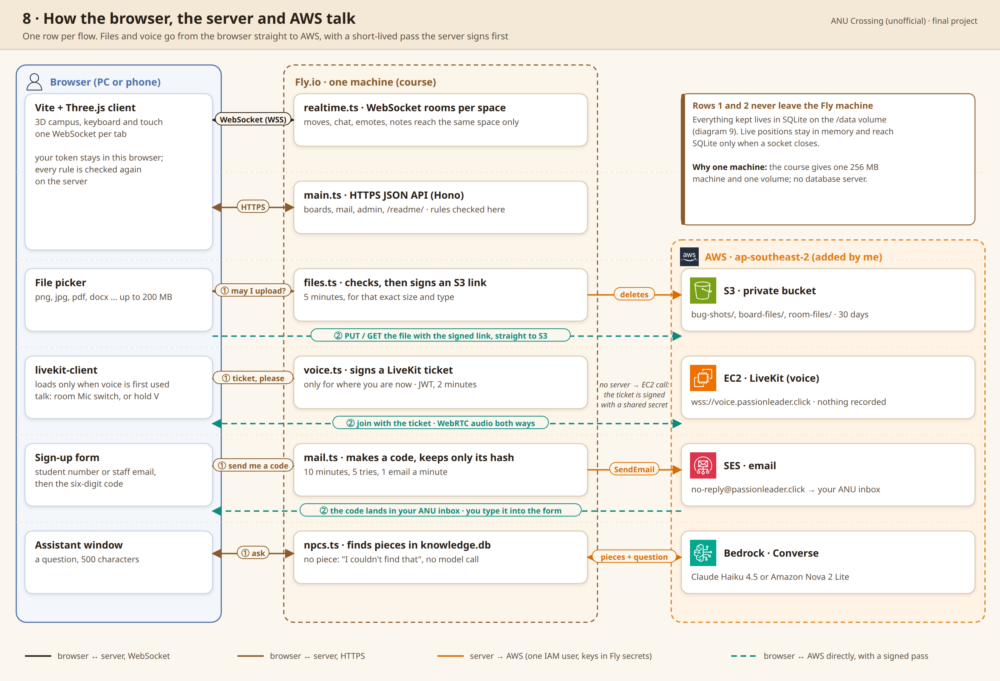

# 003: The AI assistants answer only from ANU's own pages

Status: accepted (final project)

## Context

Newcomers don't know where to ask, so the campus has AI assistants: Robin in
the library, Priya for courses, Alex for careers and others. An AI service
costs money on every question, and anyone can type anything into it. Two
things had to hold at once: the answers had to be right about ANU, and the
assistants couldn't become a free chatbot for homework or anything else.

## Options

- A. Let the model answer freely from what it already knows.
- B. Give it web search.
- C. Crawl ANU's public pages and let it answer only from those (RAG).

## Decision

I chose C. Each assistant reads its own crawled pages, and the question's best
pieces go to the model with their addresses
([98fc799](https://github.com/comp4020-agentic-coding-studio/comp4020-final-passionleader/commit/98fc799)). When no piece matches, the model still replies, but under a
brief that allows no facts at all: it says 'I couldn't find that in my pages'
and links the right pages. Courses, careers, housing run on Claude Haiku,
the rest on Amazon Nova 2 Lite, both on Bedrock
([1f07dd2](https://github.com/comp4020-agentic-coding-studio/comp4020-final-passionleader/commit/1f07dd2)). Nothing that is asked is stored.

Why: to keep out people who would use it for something else, like
assignments, and to save the AI budget. RAG then makes up for the
restriction by making answers more accurate. For a service that offers AI,
every use is money, so steering people towards efficient use is the most important part. I
also watched classmates try to dig out the API key and talk the assistants
into misbehaving. I'm glad it was built this way.

## Trade-offs

- It doesn't know what isn't on the pages. A good question with no page
  behind it gets 'I couldn't find that'.
- The pages go stale. The crawl has to run again every month.
- The only real cap on spending is the daily limit: thirty questions per
  person and fifty per assistant a day. The overall limit went from 150 to
  200 at one point ([d819ce2](https://github.com/comp4020-agentic-coding-studio/comp4020-final-passionleader/commit/d819ce2)), and when credit runs out the assistants
  say so plainly ([7354a25](https://github.com/comp4020-agentic-coding-studio/comp4020-final-passionleader/commit/7354a25)). AWS Budgets only warns.

## How it's checked

`spec/knowledge.test.ts`: an assistant answers only from its own sources,
and with nothing on its pages its brief allows no facts. An enrolment
question leads with ANU's how-to page, and it names itself as an unofficial AI
and never as a known bot.

---

I drafted this record myself, in Korean, and Claude translated it into English and corrected the grammar.
