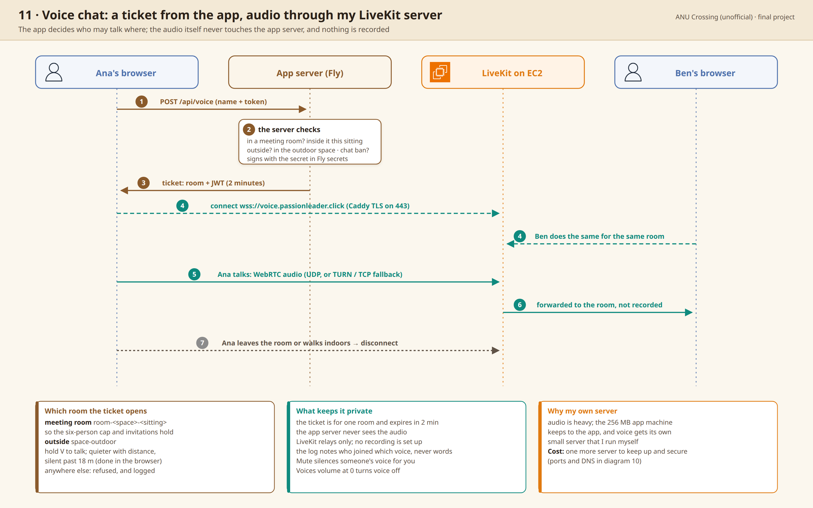

# 004: Voice runs on its own server, apart from the app

Status: accepted (final project)

## Context

People in a room should be able to talk, and outside, people near each
other too. ANU Crossing runs on anything from a low-end phone to a desktop,
and the app's own server is one 256 MB Fly machine.

## Options

- A. Browsers connect to each other directly (P2P).
- B. A paid voice service.
- C. My own LiveKit server on a small EC2 (t4g.small).

## Decision

I chose C. The app gives out a two-minute ticket, only for the voice of the place
you're in now. The audio never passes through the app's server, and nothing
is recorded ([7d000b9](https://github.com/comp4020-agentic-coding-studio/comp4020-final-passionleader/commit/7d000b9), [f9bca64](https://github.com/comp4020-agentic-coding-studio/comp4020-final-passionleader/commit/f9bca64)).

Why: P2P puts a heavy load on each client, and a phone in a room of six
would carry five streams. Sending audio through the app's server would load
a very small Fly machine and could slow the whole service. So I chose to
spend some AWS credit and keep the main service and voice apart. If credit
runs out or AWS has an outage and the EC2 goes down, ANU Crossing keeps
working, and only voice stops.

## Trade-offs

- One more server to look after, with its own ports, certificates,
  DNS (see [diagram 10](../../diagrams/10-aws-infrastructure.png)).
- It costs credit every hour it runs, used or not.

## How it's checked

`spec/knowledge.test.ts` checks that a voice ticket is for one room, signed
with the secret and short-lived. Which voice someone may join is decided in
`server/main.ts` with the same room rules as everywhere else.

---

I drafted this record myself, in Korean, and Claude translated it into English and corrected the grammar.
