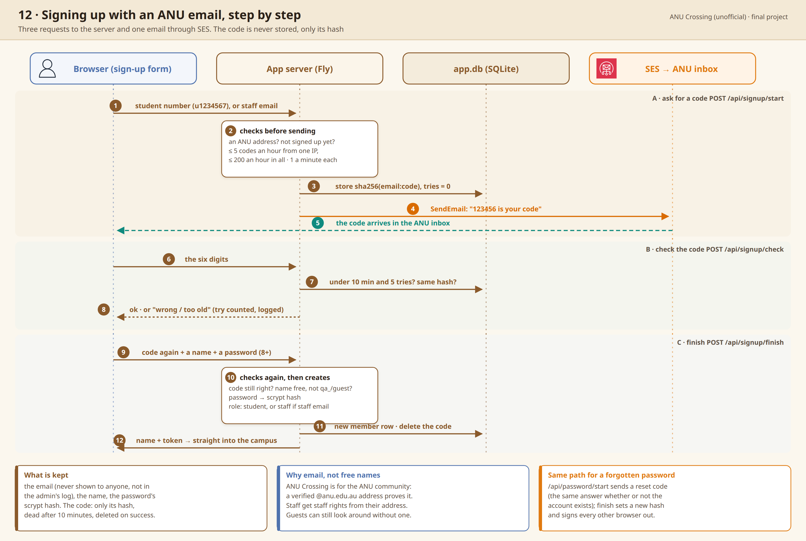

# 005: Sign up with an ANU email, not a free name

Status: accepted (final project). This answers two trade-offs in
[002](002-who-may-see-and-change-what.md): 'nobody is verified' and '"staff"
is one admin account'.

## Context

In crits 8 and 9 anyone could walk in under any name. ANU Crossing is for
ANU people, and a board or a counselling room only works if people trust
who is on the other side.

## Options

- A. Keep free names, as in crits 8 and 9.
- B. Sign in through ANU's own login (not open to a student project).
- C. A six-digit code sent to an ANU email address.

## Decision

I chose C. Students give their student number, staff tick 'I'm ANU staff' and
give their @anu.edu.au address, and a code arrives through SES. Only the
code's hash is kept ([d6ffb2d](https://github.com/comp4020-agentic-coding-studio/comp4020-final-passionleader/commit/d6ffb2d)). Signing up as staff gives staff rights,
so the roles are guest, student, staff, admin. Guests can look around,
chat, ask the assistants, but can't post. Signing in never says whether
an address has an account ([33e4795](https://github.com/comp4020-agentic-coding-studio/comp4020-final-passionleader/commit/33e4795)), and ten wrong passwords mean a
fifteen-minute wait ([d018a1e](https://github.com/comp4020-agentic-coding-studio/comp4020-final-passionleader/commit/d018a1e)). Staff open classrooms and counselling
rooms and invite students in ([7965edb](https://github.com/comp4020-agentic-coding-studio/comp4020-final-passionleader/commit/7965edb)).

Why: when I invited random people through Instagram, people outside ANU
tried to troll the boards, and the missing permissions stopped them. I built
it this way to stop trolling, protect personal information and keep the
campus safe. Students may feel anonymous, but the student number stays in
the server's log, which only the admin can read, for seven days. That is
also why there is a report button for harassment and abuse.

## Trade-offs

- SES had to be set up and approved for production first.
- Signing up takes about two minutes, which is a real step for someone
  just curious.
- Guests can do less, so a visitor sees less of what the place offers.

## How it's checked

`spec/campus.test.ts`: sign-up by code, guests and what they may not do,
password reset, the sign-in limit. `spec/rooms.test.ts`: only staff open an
empty counselling or interview room, and a student comes in by invitation.

---

I drafted this record myself, in Korean, and Claude translated it into English and corrected the grammar.
